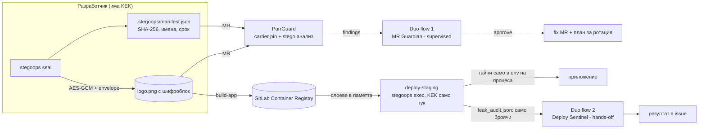

# PurrGuard · Stego-Ops
**Deploy secrets AI agents can't leak, because they never hold the key.**

Two halves of one product for the agent era:

| What it does |
|---|
| **Stego-Ops** (new) | Encrypts deploy secrets (AES-256-GCM + envelope), hides ciphertext in a normal PNG asset (logo/icon) in GitLab Container Registry, reveals it **only in memory** on the deploy job, and scrubs logs. |
| **PurrGuard** | Guards MRs against hidden exfiltration (steganography, invisible Unicode, honeytokens). Knows which PNGs are *legitimate* carriers (SHA-256 pin in manifest), so it isn't blinded by its own product, but catches a tampered carrier. |
| **Duo flows** | Two GitLab Duo Agent Platform flows orchestrate verification, approval, action, and reporting. Agents **have no key and do not read secrets** — that's the point. |

> **Honest threat model (read this first).** Security comes from **AES-256-GCM and the key (KEK)**, not steganography.
> Steganography is **camouflage**: the ciphertext doesn't look like a secret to scanners, to agents reading the repo, and doesn't enter LLM context.
> It does not replace Secret Manager/OIDC. With the `gcp-kms` provider the KEK never leaves Google Cloud KMS.
> Public repo ⇒ ciphertext is public. That's why the KEK is in a masked+protected CI variable (or KMS), and the bundle has a TTL and rotates.

## Архитектура


## Hands-off цикъл: изтичане на срок → ротация → деплой → проверка (без човек)
Тайните имат срок (по подразбиране 30 дни). Цикълът се върти сам, а **ключът остава само в CI**:

```mermaid
flowchart LR
  W[expiry-watch<br/>без ключ] -->|issue stegoops::rotation| R
  R[rotate-secrets<br/>ЕДИНСТВЕНАТА задача с KEK] -->|нов носител + манифест| MR[MR stegoops/rotate-*<br/>auto-merge]
  MR --> G[rotation-guard + PurrGuard + verify + тестове]
  G -->|зелен pipeline| M[merge в main]
  M --> B[build-app -> deploy-staging -> deploy-cloudrun]
  B -->|pipeline събитие| S[Duo flow 2: Deploy Sentinel]
  S -->|одит leak_audit.json| I[резултат в issue / нов issue при изтичане]
```

- **Агентите не вършат привилегирована работа.** Flow 2 *решава и отчита* (готовност, одит, issue); ротацията и сливането са детерминирани CI стъпки. Това е целта: AI оркестрира, но не държи ключа.
- Защити около auto-merge: `rotation-guard` проваля pipeline-а, ако ротационният MR пипа нещо различно от носителите и манифеста; PurrGuard проверява подмяна на носител; без зелен pipeline няма merge (включи *Pipelines must succeed*).
- Ръчно пускане: Build → Pipelines → Run pipeline на основния клон, или график (Schedules, напр. всеки ден).

## Допълнения за хакатона
- **MCP сървър** (`python -m stegoops.mcp_server`, конфиг `.gitlab/duo/mcp.json`): само за четене - `stegoops_verify`, `stegoops_expiry`, `purrguard_scan`. Връща имена и срокове, никога стойности. Без външни зависимости.
- **Google Cloud:** `deploy-cloudrun` (Artifact Registry + Secret Manager + Cloud Run) и `deploy/gcp_setup.sh` за еднократна подготовка. Виж `SETUP.md`.
- **Резервен режим** `--fallback-local`: ако registry клиентът не успее, носителят се чете от checkout-а; SHA-256 пинът пак се проверява.
- **Леки CI задачи:** `requirements.txt` е само ядрото; `anthropic`/Cloud Logging са в `requirements-extra.txt` и не се инсталират в CI.

## Покритие на DevSecOps етапите
Plan (issue → flow 2) · Create (fix MR от агента) · Verify (тестове + pipeline проверка) · Package (image в Container Registry) · Secure (PurrGuard, honeytokens, carrier pinning) · Release (deploy-staging) · Configure (agent-config, KEK scoping, Secret Manager по избор) · Monitor (leak audit, Cloud Logging, Pages табло) · Govern (манифест, CODEOWNERS, срокове, одит следа).

## Бърз старт (локално, без GitLab)
```bash
pip install -r requirements.txt
python tests/test_purrguard.py && python tests/test_stegoops.py && python tests/test_autopilot.py   # пълни автоматични тестове
python -m stegoops init-demo                 # прави лого, запечатва 2 ФАЛШИВИ тайни, печата STEGOOPS_KEK
export STEGOOPS_KEK=...                      # от изхода по-горе
python -m stegoops inspect --carrier app/assets/logo.png          # само имена и срок, никога стойности
python -m stegoops exec --carrier app/assets/logo.png --log-file deploy.log --report leak_audit.json -- python deploy/smoke.py
python main.py                               # PurrGuard разпознава носителя като авторизиран
```
Ключови команди: `keygen` · `seal --carrier F --from-env NAME… | --json -` · `inspect` · `exec` · `rotate` · `verify` · `decoy`.
Тайните не се подават през argv (вижда се в `ps`/историята): ползвай `--from-env` или `--json -` (stdin).

## Настройка
Пълни стъпки (GitLab, променливи, flows, Google Cloud, график, демо): **[SETUP.md](SETUP.md)**.

## Как PurrGuard и Stego-Ops не си пречат
Файл от манифеста е легитимен само ако SHA-256 съвпада с манифеста от **доверена** версия (при MR - базовият комит, който MR не може да промени).
`ok` → пропуска се LSB анализът · `resealed` (носител+манифест променени заедно) → MEDIUM, иска преглед, не блокира · `tampered` → HIGH в MR / CRITICAL иначе.
Нов/подправен манифест в MR → MEDIUM преглед. Fixer-ът никога не „почиства" авторизиран носител.

## Какво е измерено (честно)
- Сурова детекция: с малък payload (напр. 2 тайни) χ² тестът на PurrGuard **не** засича носителя; с ~12 KB payload го засича (HIGH). Затова доверието е в SHA-256 пина, а не в „невидимост".
- Промяна по пикселите: най-много 1/255 на канал. Sequential LSB четци (напр. zsteg) не намират нищо четимо - позициите са ключови.
- Ротацията презаписва старите позиции със случаен шум, за да не остане старо шифротекст в картинката.
- **Decoy носители:** `stegoops decoy` слага регистриран honeytoken с обикновен последователен LSB; ако някой го „разкодира" и стойността се появи другаде - CRITICAL без фалшива тревога.

## Честни ограничения
- **Не е тествано** срещу реален GitLab, Container Registry, Duo Agent Platform, Cloud KMS и Cloud Run. Registry клиентът е тестван с фалшив регистър, а ротацията (issue/branch/commit/MR/auto-merge) - с фалшив GitLab API; YAML-ите на flows са проверени за структура и референции, но не са пускани в Duo (имената на инструментите и триггерите трябва да се потвърдят в твоята инстанция/версия - flow builder-ът валидира).
- Дъщерният процес може да запише тайна във файл или да я прехвърли в друго кодиране; скруберът покрива суров/base64/hex/URL/JSON вид и редове на PEM, не всичко. `leak_audit.json` отчита остатъчни шаблони.
- Който може да пусне код в deploy задачата, може да вземе тайните (както при всяка CI тайна). Защити: protected branch, environment scoping, CODEOWNERS, KMS.
- Стеганографията е крехка: рекомпресия/преоразмеряване на PNG (CDN, оптимизатори) я разрушава. Верният файл се пази от SHA-256 пина.
- В flow средата сканът обхваща всички проследявани файлове (няма `CI_MERGE_REQUEST_DIFF_BASE_SHA`); пълният MR режим е в CI задачата `purrguard-mr`.
- Всички демо тайни са **ФАЛШИВИ**.

## PurrGuard (оригиналният скенер)
```bash
python main.py                  # скан (в CI - само файловете от MR)
python main.py history          # скан на цялата git история
python main.py report           # табло -> public/index.html
python main.py explain demo_files/*     # доказателства + команди за независима проверка
python main.py sanitize <файлове>       # изчиства скрито съдържание (използва се от flow след одобрение)
python main.py honey init <gcp-проект>  # honeytokens
python main.py allow <файл>             # SHA-256 за allowlist
```
Засича: PNG (данни след IEND, нестандартни чънкове, LSB χ²), JPEG/MP3/WAV/PDF структура, невидим Unicode, honeytokens, промени спрямо основния клон.
Google Cloud Logging, Slack и план за ротация са както преди (виж `integrations/`). `PURRGUARD_MOCK=1` изключва директните Anthropic заявки - в тази версия разсъжденията са в Duo flows.

## Лиценз
MIT.
