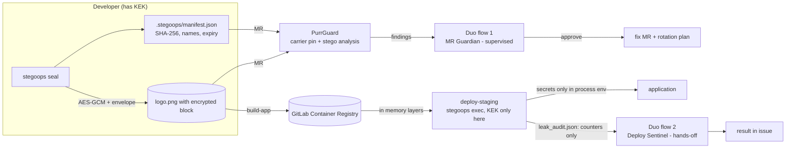

# PurrGuard · Stego-Ops
**Deploy secrets AI agents can't leak, because they never hold the key.**

Two halves of one product for the agent era:

| What it does |
|---|
| **Stego-Ops** (new) | Encrypts deploy secrets (AES-256-GCM + envelope), hides ciphertext in a normal PNG asset (logo/icon) in GitLab Container Registry, reveals it **only in memory** on the deploy job, and scrubs logs. |
| **PurrGuard** | Guards MRs against hidden exfiltration (steganography, invisible Unicode, honeytokens). Knows which PNGs are *legitimate* carriers (SHA-256 pin in manifest), so it isn't blinded by its own product, but catches a tampered carrier. |
| **Duo flows** | Two GitLab Duo Agent Platform flows orchestrate verification, approval, action, and reporting. Agents **have no key and do not read secrets** — that's the point. |

> **Honest threat model (read this first).** Security comes from **AES-256-GCM and the key (KEK)**, not steganography.
> Steganography is **camouflage**: the ciphertext doesn't look like a secret to scanners, to agents reading the repo, and doesn't enter LLM context.
> It does not replace Secret Manager/OIDC. With the `gcp-kms` provider the KEK never leaves Google Cloud KMS.
> Public repo ⇒ ciphertext is public. That's why the KEK is in a masked+protected CI variable (or KMS), and the bundle has a TTL and rotates.

## Links
- **Showcase repository (hackathon):** https://gitlab.com/gitlab-ai-hackathon/transcend-october-2026/43043338/showcase
- **Live dashboard (GitLab Pages):** https://gitlab-ai-hackathon.gitlab.io/transcend-october-2026/43043338/showcase/
- **Mirror:** https://github.com/jacquelinegg/PurrGuard

## Architecture


## Hands-off cycle: expiry → rotation → deploy → check (no human)
Secrets have a TTL (default 30 days). The cycle runs by itself, and **the key stays only in CI**:

```mermaid
flowchart LR
  W[expiry-watch<br/>no key] -->|issue stegoops::rotation| R
  R[rotate-secrets<br/>ONLY job with KEK] -->|new carrier + manifest| MR[MR stegoops/rotate-*<br/>auto-merge]
  MR --> G[rotation-guard + PurrGuard + verify + tests]
  G -->|green pipeline| M[merge into main]
  M --> B[build-app -> deploy-staging -> deploy-cloudrun]
  B -->|pipeline event| S[Duo flow 2: Deploy Sentinel]
  S -->|audit leak_audit.json| I[result in issue / new issue on leak]
```

- **Agents do not perform privileged work.** Flow 2 *decides and reports* (readiness, audit, issue); rotation and merging are deterministic CI steps. That's the goal: AI orchestrates, but doesn't hold the key.
- Controls around auto-merge: `rotation-guard` fails the pipeline if the rotation MR touches anything other than carriers and manifest; PurrGuard checks for carrier substitution; no green pipeline means no merge (enable *Pipelines must succeed*).
- Manual run: Build → Pipelines → Run pipeline on the main branch, or schedule (Schedules, e.g. every day).

## Hackathon additions
- **MCP server** (`python -m stegoops.mcp_server`, config `.gitlab/duo/mcp.json`): read-only - `stegoops_verify`, `stegoops_expiry`, `purrguard_scan`. Returns names and expiries, never values. No external dependencies.
- **Google Cloud:** `deploy-cloudrun` (Artifact Registry + Secret Manager + Cloud Run) and `deploy/gcp_setup.sh` for one-time setup. See `SETUP.md`.
- **Fallback mode** `--fallback-local`: if the registry client fails, the carrier is read from the checkout; SHA-256 pin is still verified.
- **Lightweight CI jobs:** `requirements.txt` is just the core; `anthropic`/Cloud Logging are in `requirements-extra.txt` and are not installed in CI.

## DevSecOps stage coverage
Plan (issue → flow 2) · Create (fix MR from agent) · Verify (tests + pipeline check) · Package (image in Container Registry) · Secure (PurrGuard, honeytokens, carrier pinning) · Release (deploy-staging) · Configure (agent-config, KEK scoping, Secret Manager optional) · Monitor (leak audit, Cloud Logging, Pages dashboard) · Govern (manifest, CODEOWNERS, expiries, audit trail).

## Quick start (locally, without GitLab)
```bash
pip install -r requirements.txt
python tests/test_purrguard.py && python tests/test_stegoops.py && python tests/test_autopilot.py   # full automated tests
python -m stegoops init-demo                 # creates logo, seals 2 FAKE secrets, prints STEGOOPS_KEK
export STEGOOPS_KEK=...                      # from the output above
python -m stegoops inspect --carrier app/assets/logo.png          # names and expiry only, never values
python -m stegoops exec --carrier app/assets/logo.png --log-file deploy.log --report leak_audit.json -- python deploy/smoke.py
python main.py                               # PurrGuard recognizes the carrier as authorized
```
Key commands: `keygen` · `seal --carrier F --from-env NAME… | --json -` · `inspect` · `exec` · `rotate` · `verify` · `decoy`.
Secrets are not passed via argv (visible in `ps`/history): use `--from-env` or `--json -` (stdin).

## Setup
Full steps (GitLab, variables, flows, Google Cloud, schedule, demo): **[SETUP.md](SETUP.md)**.

## How PurrGuard and Stego-Ops don't interfere with each other
A manifest file is legitimate only if its SHA-256 matches the manifest from a **trusted** version (in an MR - the base commit that the MR cannot change).
`ok` → LSB analysis is skipped · `resealed` (carrier+manifest changed together) → MEDIUM, needs review, does not block · `tampered` → HIGH in MR / CRITICAL otherwise.
New/tampered manifest in MR → MEDIUM review. The fixer never "cleans" an authorized carrier.

## What is measured (honestly)
- Raw detection: with a small payload (e.g. 2 secrets) PurrGuard's χ² test **does not** detect the carrier; with ~12 KB payload it detects it (HIGH). That's why trust is in the SHA-256 pin, not "invisibility".
- Pixel change: at most 1/255 per channel. Sequential LSB readers (e.g. zsteg) find nothing readable - the positions are key.
- Rotation overwrites old positions with random noise so old ciphertext does not remain in the image.
- **Decoy carriers:** `stegoops decoy` places a registered honeytoken with ordinary sequential LSB; if someone "decodes" it and the value appears elsewhere - CRITICAL without false alarm.

## Honest limitations
- **Not tested** against real GitLab, Container Registry, Duo Agent Platform, Cloud KMS, and Cloud Run. The registry client is tested with a fake registry, and rotation (issue/branch/commit/MR/auto-merge) is tested with a fake GitLab API; flow YAMLs are checked for structure and references, but not run in Duo (tool names and triggers must be confirmed in your instance/version - the flow builder validates).
- The child process may write a secret to a file or transfer it to another encoding; the scrubber covers raw/base64/hex/URL/JSON forms and PEM lines, not everything. `leak_audit.json` accounts for residual patterns.
- Whoever can push code to the deploy job can take the secrets (as with any CI secret). Protections: protected branch, environment scoping, CODEOWNERS, KMS.
- Steganography is fragile: PNG recompression/resizing (CDN, optimizers) destroys it. The correct file is protected by the SHA-256 pin.
- In the flow environment, the scan covers all tracked files (no `CI_MERGE_REQUEST_DIFF_BASE_SHA`); the full MR mode is in the CI job `purrguard-mr`.
- All demo secrets are **FAKE**.

## Demo files (intentionally infected)
`demo_files/` contains **deliberately infected samples** (LSB, trailing bytes, text chunks, PDF embedded files, invisible Unicode, WAV chunk) used to test and demonstrate the scanner. They are test fixtures, not real secrets — all values are FAKE. Do not "clean" them; they are the proof the scanner works.

## PurrGuard (the original scanner)
```bash
python main.py                  # scan (in CI - only MR files)
python main.py history          # scan entire git history
python main.py report           # dashboard -> public/index.html
python main.py explain demo_files/*     # evidence + commands for independent verification
python main.py sanitize <files>       # cleans hidden content (used by flow after approval)
python main.py honey init <gcp-project>  # honeytokens
python main.py allow <file>             # SHA-256 for allowlist
```
Detects: PNG (data after IEND, non-standard chunks, LSB χ²), JPEG/MP3/WAV/PDF structure, invisible Unicode, honeytokens, changes against the base branch.
Google Cloud Logging, Slack, and rotation plan are as before (see `integrations/`). `PURRGUARD_MOCK=1` disables direct Anthropic calls - in this version reasoning is in Duo flows.

## License
MIT.

<!-- pipeline trigger 2026-10-06 18:47:09 -->

<!-- pipeline trigger 2026-10-06 18:56:09 -->
